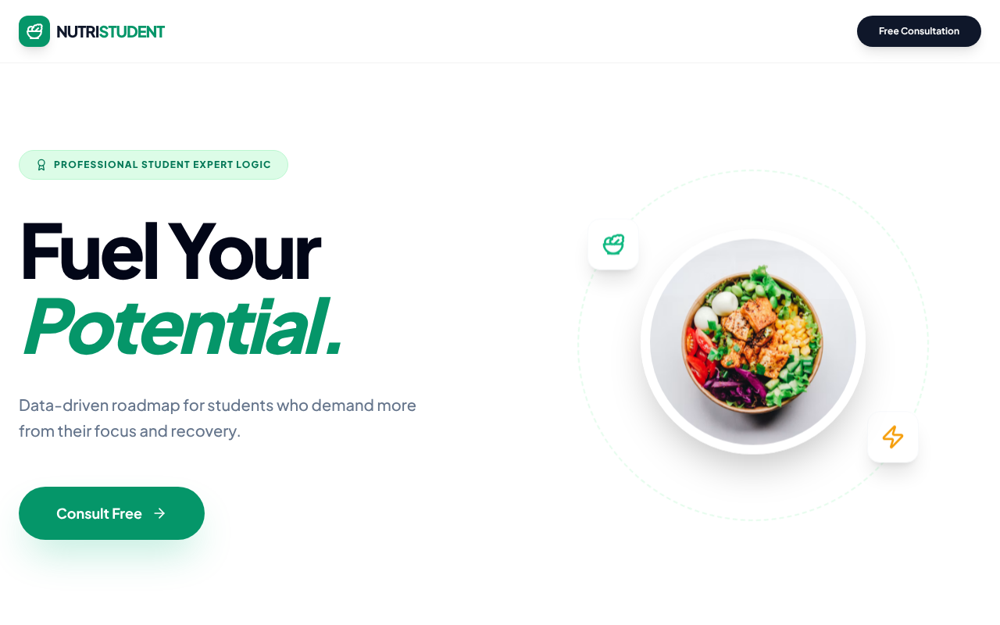

# NutriStudent — Diet Expert System for Students

A rule-based **expert system** that recommends a personalised diet strategy for university students, built as a React web app. Students answer a short consultation (body profile, goal, exercise, diet restrictions, health condition, stress, budget and cooking facilities), and the inference engine produces a diet plan, food type, meal portion and health advisory. An optional AI step uses Google Gemini to generate a matching recipe.



## Features
- **Knowledge base of 271 IF–THEN rules** covering BMI category, goal, age, stress, budget, restrictions, health conditions and cooking facilities
- **Inference engine** that fires the matching rules and explains the resulting diet plan, food type and portion advice
- **Rule tooling**: a generator that builds the rule set, scripts that export every rule as readable IF–THEN text, and a dependency report confirming every rule can fire
- **AI recipe suggestion** with Google Gemini (falls back across several Gemini models)
- **Admin dashboard** to view, edit, delete and export consultation records to CSV

## Tech stack
React 19 · Vite · Tailwind CSS · Lucide icons · Google Gemini API

## Project structure
```
src/
  App.jsx                    # UI, consultation flow, inference and admin dashboard
  rules/
    generator.js             # builds the rule objects
    rules.generated.pruned.js# final rule base used by the app
    all_rules_if_then.txt    # every rule in readable IF–THEN form
    reports/                 # rule dependency report
scripts/                     # rule listing, formatting and analysis scripts
```

## Run it locally
```bash
npm install
cp .env.example .env         # then add your own Gemini API key
npm run dev
```
The app works without a key; only the AI recipe step needs one.

## Example rules
```
IF BMI_Category == 'Underweight' AND goal == 'Gain' THEN Diet_Plan = 'Calorie-Surplus'
IF cooking_facility == 'No Kitchen' THEN Food_Type = 'No-Cook Meals'
IF Diet_Plan == 'Calorie-Deficit' OR health_condition == 'High BP' THEN Meal_Portion = 'Small Frequent Meals'
```

> Built for an Expert Systems course, Bachelor of Information Systems (Hons.) Intelligent Systems Engineering, UiTM Shah Alam. Recommendations are for learning purposes and are not medical advice.
